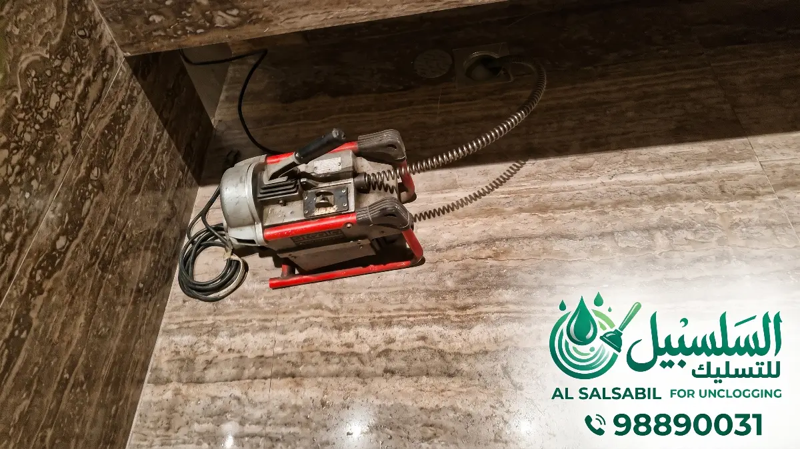
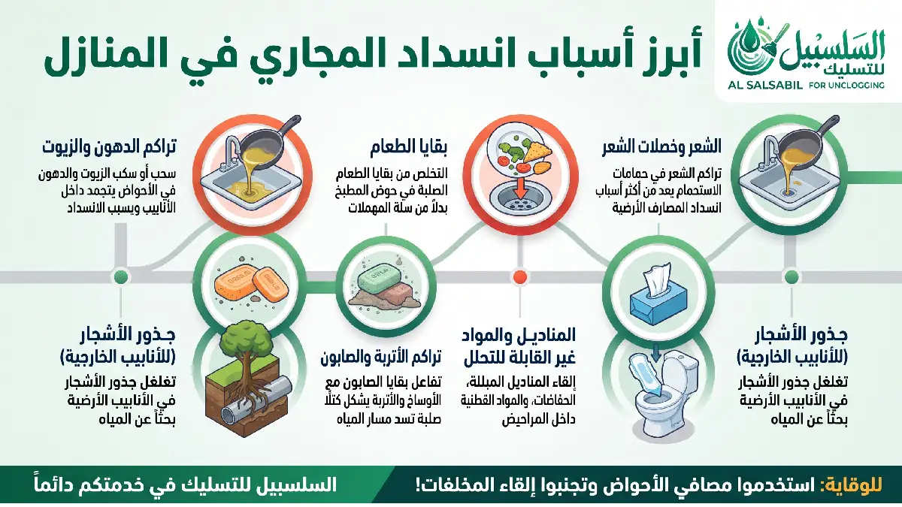
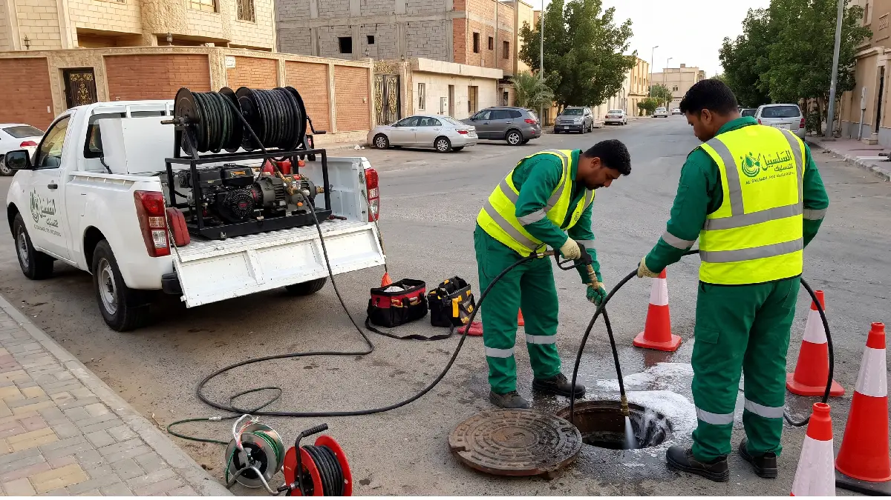
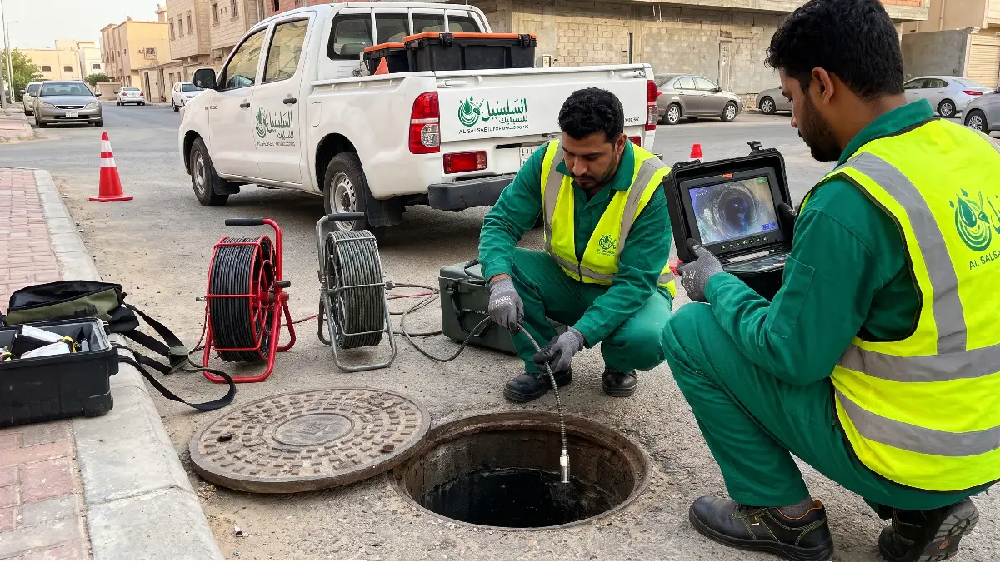

انسداد المجاري من المشكلات التي لا تحتمل التأجيل: ماء لا ينزل من الحوض، ورائحة تنتشر في البيت، وأحيانًا ماء يرتد من بالوعة الحمام. وفي الجهراء تتكرر هذه المشكلة كثيرًا لأسباب ترتبط بطبيعة المنطقة نفسها، مثل البيوت القديمة ذات الأنابيب المستهلكة، والحدائق المنزلية، والأتربة والرمال التي تدخل إلى خطوط الصرف.

في هذا الدليل نشرح خدمة **تسليك مجاري الجهراء** بالتفصيل: كيف تعرف أن مجاري بيتك تحتاج إلى تسليك، وما أسباب الانسداد، وما الطريقة المناسبة لكل حالة، وما الذي يحدد السعر، وكيف تتجنب تكرار المشكلة.

## علامات تدل على أن مجاري بيتك تحتاج إلى تسليك

الانسداد نادرًا ما يحدث فجأة، فهو يبدأ بإشارات صغيرة تزداد مع الوقت. انتبه لهذه العلامات:

- **بطء التصريف:** الماء يأخذ وقتًا أطول من المعتاد لينزل من حوض المطبخ أو المغسلة أو أرضية الحمام.
- **صوت قرقرة أو فقاعات:** تسمعه من البالوعة بعد سحب السيفون أو تصريف الماء، وسببه هواء محبوس خلف الانسداد.
- **رائحة كريهة:** تنبعث من البواليع أو المطبخ، وتعني غالبًا أن غازات الصرف لم تعد تجد طريقها الطبيعي للخروج.
- **ارتداد الماء:** يخرج الماء من بالوعة الأرضية أو الدش عند استخدام المرحاض أو الغسالة.
- **ارتفاع منسوب الماء في الحمام** أثناء الاستحمام.
- **رطوبة أو تسريب** حول فتحات الصرف.

إذا ظهرت هذه العلامات في **أكثر من مكان في البيت في الوقت نفسه**، فالمشكلة غالبًا في خط الصرف الرئيسي وليست في بالوعة واحدة، وهذه حالة تحتاج إلى تدخل سريع.

## أسباب انسداد المجاري في الجهراء

معرفة السبب هي نصف الحل، لأنها تحدد طريقة التسليك المناسبة، وتساعدك على منع تكرار المشكلة.

### تراكم الدهون والزيوت في المطبخ

هو السبب الأكثر شيوعًا في المطابخ. الزيوت التي تنزل مع ماء غسيل الأواني تبرد داخل الأنابيب وتتصلب طبقةً فوق طبقة، حتى يضيق مجرى الماء أو يُغلق تمامًا.

### الشعر وبقايا الصابون في الحمامات

يلتف الشعر داخل بالوعة الدش والمغسلة، ثم يلتصق به الصابون فيتكون منه سدادة متماسكة تعيق التصريف.

### المناديل والمخلفات الصلبة

المناديل المبللة ومناديل المطبخ لا تتحلل في الماء مثل ورق التواليت، ورميها في المرحاض من أكثر أسباب الانسدادات الشديدة. والأمر نفسه ينطبق على الحفاضات والفوط الصحية وبقايا الطعام.

### الترسبات الكلسية

مع مرور السنوات تتكون ترسبات داخل جدران الأنابيب تضيّق قطرها تدريجيًا، فيبطؤ التصريف حتى يتوقف.

### الرمال والأتربة

بحكم قرب الجهراء من المناطق الصحراوية، تدخل الأتربة والرمال إلى بواليع الحوش والسطح، خاصة بعد العواصف الترابية أو غسيل الأرضيات، وتترسب في الخطوط الأفقية.

### جذور الأشجار

في البيوت التي فيها حدائق، تبحث جذور الأشجار عن الرطوبة فتتسلل إلى الأنابيب من الوصلات أو الشروخ، وتسبب انسدادات متكررة وقد تكسر الأنبوب نفسه.

### الأنابيب القديمة والخطوط المشتركة

بعض البيوت في الجهراء أنابيبها قديمة ومستهلكة، فتتكرر فيها الانسدادات مهما تم فتحها من السطح. وفي حالات أخرى يكون خط الصرف مشتركًا بين بيتين متجاورين، فيظهر الانسداد في بيت بينما سببه في الجزء المشترك من الخط.

## طرق تسليك المجاري: أيها يناسب حالتك؟

لا توجد طريقة واحدة تصلح لكل انسداد. يختار الفني الطريقة حسب نوع الانسداد ومكانه وشدته:

| الطريقة | متى تُستخدم | مميزاتها | ملاحظات |
|---|---|---|---|
| التسليك اليدوي (السوستة) | الانسدادات الخفيفة القريبة من فتحة البالوعة | سريعة وتكلفتها منخفضة | لا تصلح للانسدادات العميقة |
| ماكينة التسليك الحلزونية (السبرنج) | الانسدادات المتوسطة في الحمامات والمطابخ | تكسر الانسداد وتسحبه دون إضرار بالأنابيب | تحتاج إلى فني متمرس |
| التسليك بضغط الماء العالي | الانسدادات الشديدة، والدهون، والرمال، والخط الرئيسي | تنظف جدران الأنبوب بالكامل لا فتحة فيه فقط | تكلفتها أعلى من الطرق اليدوية |
| الفحص بالكاميرا | الانسدادات المتكررة أو مجهولة السبب | تحدد مكان المشكلة ونوعها بدقة قبل العمل | تُضاف إلى التسليك ولا تغني عنه |

### التسليك بالماكينة الحلزونية

يُدخل الفني سلكًا مرنًا ينتهي برأس حلزوني داخل الأنبوب، وتدور الماكينة به حتى يصل إلى الانسداد فيفتته أو يلتقطه ويسحبه للخارج. هذه هي الطريقة الأكثر استخدامًا في انسدادات البيوت اليومية.

### التسليك بضغط الماء العالي

يُضخ الماء بضغط مرتفع جدًا داخل الأنبوب عبر خرطوم خاص، فيزيل الدهون المتصلبة والرمال والترسبات من جدران الأنبوب، ويعيد له قطره الطبيعي. وهي أنسب طريقة للخط الرئيسي وللانسدادات التي تتكرر بسبب الدهون أو الرمال.

### الفحص بالكاميرا

في الحالات المتكررة، يُدخل الفني كاميرا صغيرة داخل الأنبوب ليرى مكان الانسداد وسببه: دهون، أو جذور، أو كسر، أو هبوط في الخط. هذا يوفر عليك الوقت والمال، لأنه يحدد الحل الصحيح من البداية بدل التجربة.

## انسداد في بالوعة واحدة أم في الخط الرئيسي؟

هذا السؤال يحدد حجم العمل وتكلفته، وتستطيع أن تكوّن فكرة مبدئية بنفسك:

- **إذا كانت المشكلة في بالوعة واحدة فقط** (حوض المطبخ مثلًا) وباقي البيت يصرّف بشكل طبيعي، فالانسداد غالبًا في الفرع الخاص بهذه البالوعة.
- **إذا كانت المشكلة في كل البواليع** أو في أكثر من حمام، أو كان الماء يرتد في الأرضيات، فالانسداد غالبًا في الخط الرئيسي للمنزل.
- **إذا ظهرت المشكلة عندك وعند جارك في الوقت نفسه،** فقد يكون الانسداد في خط مشترك بينكما، وهنا لا يفيد فتح البواليع الداخلية، بل يجب الوصول إلى موضع الانسداد في الخط المشترك.
- **وإذا كان الخط الرئيسي للمنزل سليمًا** والمشكلة مستمرة، فقد تكون في شبكة الصرف العامة خارج حدود البيت، وفي هذه الحالة يوضح لك الفني ذلك لتتواصل مع الجهة المختصة.

## خطوات تسليك المجاري عند الزيارة

1. **الاستماع إلى المشكلة:** تصف لنا ما يحدث ومكانه ومنذ متى بدأ.
2. **الفحص والتشخيص:** يفحص الفني البواليع والخطوط لتحديد مكان الانسداد، ويستخدم الكاميرا عند الحاجة.
3. **شرح المشكلة والاتفاق على السعر:** نوضح لك سبب الانسداد والحل المقترح والتكلفة قبل البدء.
4. **التسليك بالطريقة المناسبة:** يدويًا، أو بالماكينة الحلزونية، أو بضغط الماء، حسب الحالة.
5. **اختبار التصريف:** نتأكد من أن الماء ينزل بشكل طبيعي في كل النقاط المتأثرة.
6. **تنظيف مكان العمل وتقديم النصائح:** نترك المكان نظيفًا، ونرشدك إلى ما يمنع تكرار المشكلة.

## أسعار تسليك المجاري في الجهراء

لا يوجد سعر ثابت لكل الحالات، لأن التكلفة تعتمد على عدة عوامل:

- **عدد البواليع** التي تحتاج إلى تسليك.
- **شدة الانسداد ونوعه:** انسداد شعر بسيط يختلف عن دهون متصلبة أو رمال.
- **مكان الانسداد:** بالوعة فرعية أم خط رئيسي.
- **الطريقة المستخدمة:** يدوي، أو ماكينة، أو ضغط ماء، أو فحص بالكاميرا.
- **وجود أعمال إضافية** مثل إصلاح أنبوب مكسور أو استبداله، وهذه تُسعّر منفصلة بعد الفحص.

| الخدمة | السعر التقريبي |
|---|---|
| تسليك بالوعة مطبخ أو حمام (انسداد بسيط) | من 7 إلى 10 د.ك |
| تسليك بالوعة (انسداد شديد) | من 12 إلى 20 د.ك |
| تسليك الخط الرئيسي للمنزل | من 25 إلى 40 د.ك |
| تسليك بضغط الماء العالي | من 30 إلى 50 د.ك |
| فحص المواسير بالكاميرا | من 15 إلى 25 د.ك |

*الأسعار تقريبية، ويتحدد السعر النهائي بعد المعاينة ويُتفق عليه قبل بدء العمل.*

نصيحة مهمة: التسليك المبكر أرخص دائمًا. الانسداد الجزئي الذي يُحل في دقائق، إذا تُرك أسابيع، قد يتحول إلى انسداد في الخط الرئيسي يحتاج إلى معدات أكبر ووقت أطول وتكلفة مضاعفة.

## أخطاء شائعة عند انسداد المجاري

- **استخدام المواد الكيميائية الحارقة:** قد تفتح ممرًا صغيرًا مؤقتًا، لكنها تؤذي الأنابيب البلاستيكية والوصلات مع التكرار، ولا تزيل سبب الانسداد. كما أنها خطرة على الفني إذا استُخدمت قبل وصوله.
- **رمي مسحوق الغسيل أو الملح في المرحاض:** لا يحل الانسداد، وقد يزيد الترسبات.
- **تجاهل العلامات الأولى:** بطء التصريف والرائحة إنذار مبكر، وتأجيله يرفع التكلفة.
- **الاكتفاء بفتح الانسداد من السطح في كل مرة:** إذا كانت المشكلة تتكرر كل فترة، فهناك سبب أعمق في الخط يحتاج إلى فحص.
- **الاستعانة بغير المتخصصين:** التسليك الخاطئ قد يدفع الانسداد إلى عمق أكبر أو يكسر الأنبوب.

## نصائح تحمي مجاري بيتك من الانسداد

- لا تصب الزيوت والدهون في حوض المطبخ، بل اجمعها في وعاء وتخلص منها مع النفايات.
- ركّب مصفاة صغيرة على بالوعة الدش والمغسلة لتمنع دخول الشعر.
- لا ترمِ المناديل المبللة أو الفوط الصحية أو بقايا الطعام في المرحاض.
- اسكب ماءً ساخنًا (غير مغلي) في بالوعة المطبخ من وقت لآخر لتقليل تراكم الدهون.
- غطِّ بواليع الحوش والسطح أثناء العواصف الترابية، ونظّفها بعدها.
- إذا كان في بيتك أشجار قريبة من خطوط الصرف، افحص الخط بشكل دوري.
- في البيوت القديمة، اجعل صيانة المجاري وقائية كل فترة بدل انتظار الانسداد.

## مناطق الجهراء التي نغطيها

نقدم خدمة تسليك المجاري في مختلف مناطق محافظة الجهراء، ومنها: الجهراء القديمة، والقصر، والعيون، والنسيم، والواحة، وتيماء، والصليبية، وسعد العبدالله، وجابر الأحمد، والمطلاع، والنعيم، وأمغرة، وكبد.

## الأسئلة الشائعة عن تسليك مجاري الجهراء

### كم تستغرق عملية تسليك المجاري؟

الانسداد البسيط في بالوعة واحدة قد يُحل في أقل من ساعة، أما انسداد الخط الرئيسي أو الحالات التي تحتاج إلى فحص بالكاميرا فتستغرق وقتًا أطول حسب الحالة.

### هل يمكن تسليك المجاري بدون تكسير؟

نعم، في أغلب الحالات. الماكينات الحلزونية وضغط الماء والكاميرا تتيح الوصول إلى الانسداد من فتحات الصرف الموجودة. ولا يُلجأ إلى الفتح إلا إذا كان الأنبوب نفسه مكسورًا أو هابطًا.

### ما الفرق بين التسليك بالسبرنج والتسليك بالضغط؟

السبرنج يفتح ممرًا داخل الانسداد ويسحب جزءًا منه، وهو مناسب للانسدادات المتوسطة. أما ضغط الماء فينظف جدران الأنبوب بالكامل من الدهون والرمال والترسبات، فيقلل احتمال عودة الانسداد قريبًا.

### لماذا يعود الانسداد بعد فترة قصيرة من التسليك؟

غالبًا لأن التسليك فتح ممرًا صغيرًا فقط ولم يُزل الترسبات من جدران الأنبوب، أو لأن السبب الحقيقي (جذور، أو كسر، أو خط قديم) لم يُشخّص. الفحص بالكاميرا يحسم هذا.

### هل المواد الكيميائية آمنة لفتح الانسداد؟

لا ننصح بها. فهي تضر بالأنابيب مع الاستخدام المتكرر، ونادرًا ما تحل انسدادًا حقيقيًا في الخط.

### كيف أعرف أن المشكلة في الخط الرئيسي؟

إذا تأثرت كل بواليع البيت أو أكثر من حمام في الوقت نفسه، أو ارتد الماء في الأرضيات عند استخدام المرحاض، فالمشكلة غالبًا في الخط الرئيسي.

### هل تعملون في الليل والإجازات؟

[اكتب هنا مواعيد العمل الفعلية، مثلًا: نعم، الخدمة متاحة 24 ساعة طوال أيام الأسبوع.]

## اطلب خدمة تسليك مجاري الجهراء الآن

لا تنتظر حتى يتحول البطء إلى انسداد كامل. تواصل معنا واذكر منطقتك في الجهراء، ونوع البالوعة المتأثرة، وهل المشكلة في نقطة واحدة أم في أكثر من مكان، وسنحدد لك الحل المناسب والتكلفة قبل البدء.

📞 اتصل الآن: [+965 98890031](tel:+96598890031)
💬 واتساب: [راسلنا على واتساب](https://wa.me/96598890031)
